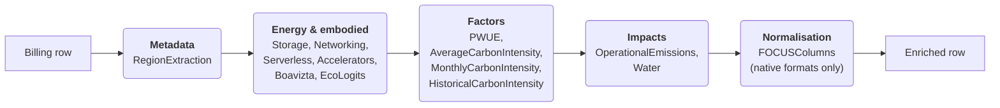

# Enrichment modules: AWS and Azure service coverage

SPRUCE generates its estimates by chaining **EnrichmentModules**.
An `EnrichmentModule` is the unit of extension in SPRUCE. Each module reads columns from
the CUR input row and/or from values set by earlier modules, then writes its results into a
shared map. The pipeline materialises one output row per CUR row at the end, avoiding
per-module row copies.

The enrichment modules are listed and configured in a configuration file, one per cloud provider and report format. If no configuration is specified, SPRUCE uses the bundled default for the active provider (e.g. [`default-config-aws.json`](https://github.com/DigitalPebble/spruce/blob/main/src/main/resources/default-config-aws.json) for a native AWS CUR, or [`default-config-aws-focus.json`](https://github.com/DigitalPebble/spruce/blob/main/src/main/resources/default-config-aws-focus.json) / [`default-config-azure-focus.json`](https://github.com/DigitalPebble/spruce/blob/main/src/main/resources/default-config-azure-focus.json) for an AWS or Azure [FOCUS](https://focus.finops.org/) report).
See [Configure the modules](howto/config_modules.md) for instructions on how to modify the enrichment modules, and [Write a module](howto/write_module.md) to add your own.
The list of columns generated by the modules can be found in the [SpruceColumn](https://github.com/DigitalPebble/spruce/blob/main/src/main/java/com/digitalpebble/spruce/SpruceColumn.java) class.

!!! note "Native and FOCUS report formats"
    A FOCUS export carries mostly the same values as the provider's native export under different
    column names (e.g. for Azure `x_SkuMeterCategory` instead of `MeterCategory`, for AWS `x_Operation`
    instead of `line_item_operation` and `SkuMeter` instead of `line_item_usage_type`). The provider
    modules therefore work for both formats: when the report format is FOCUS, they automatically
    rebind their input columns to the FOCUS names. Two AWS specificities: `x_ServiceCode` carries the
    CUR product code (`line_item_product_code`), and the columns with no FOCUS equivalent are derived
    from `SkuMeter` — the instance type from meters like `BoxUsage:m5.large` and the data transfer
    category from the meter suffixes (`DataTransfer-Regional-Bytes`, `AWS-Out-Bytes`, ...).

## The pipeline at a glance

The modules run in sequence and fall into five stages. Later stages consume the columns
written by earlier ones, which is why the order in the configuration file matters.



| Module | Providers | Writes | Based on |
|---|---|---|---|
| [RegionExtraction](#regionextraction) | AWS, Azure, FOCUS | `region` | — |
| [Storage](#storage) | AWS, Azure | `operational_energy_kwh`, `embodied_emissions_co2eq_g` | [Cloud Carbon Footprint](https://www.cloudcarbonfootprint.org/) for energy, [Boavizta](https://doc.api.boavizta.org/) and vendor LCAs for embodied |
| [Networking](#networking) | AWS, Azure | `operational_energy_kwh` | [Boavizta](https://boavizta.org/) coefficients |
| [Serverless](#serverless) | AWS | `operational_energy_kwh` | [Tailpipe](https://tailpipe.ai/methodology/serverless-explained/) |
| [Accelerators](#accelerators) | AWS | `operational_energy_kwh` | [Cloud Carbon Footprint](https://www.cloudcarbonfootprint.org/) |
| [Compute — Boavizta](#compute-boavizta) | AWS, Azure | `operational_energy_kwh`, `embodied_emissions_co2eq_g`, `embodied_adp_sbeq_g` | [BoaviztAPI](https://doc.api.boavizta.org/) |
| [LLM inference — EcoLogits](#llm-inference-ecologits) | AWS, Azure | `operational_energy_kwh`, `embodied_emissions_co2eq_g` | [EcoLogits](https://ecologits.ai/) |
| [PWUE](#pwue) | AWS, Azure | `power_usage_effectiveness`, `water_usage_effectiveness` | Provider-published data |
| [AverageCarbonIntensity](#averagecarbonintensity) | AWS, Azure | `carbon_intensity` | [Ember](https://ember-energy.org/) |
| [MonthlyCarbonIntensity](#monthlycarbonintensity) | AWS, Azure (regions in Great Britain) | `carbon_intensity` | [Carbon Intensity API](https://carbonintensity.org.uk/) and [Ember](https://ember-energy.org/) |
| [HistoricalCarbonIntensity](#historicalcarbonintensity) | AWS, Azure (not in the default configurations) | `carbon_intensity` | [WattTime](https://watttime.org/) |
| [OperationalEmissions](#operationalemissions) | AWS, Azure | `operational_emissions_co2eq_g` | — |
| [Water](#water) | AWS, Azure | `water_cooling_l`, `water_electricity_production_l`, `water_consumption_stress_area_l` | [WRI](https://www.wri.org/) |
| [FOCUSColumns](#focuscolumns) | AWS, Azure (native formats) | [FOCUS](https://focus.finops.org/) columns | — |

## Stage 1 — Metadata extraction

### RegionExtraction

Extracts the region information from the provider-specific input columns and stores it in
a standard location, where all the following modules can find it. The FOCUS variant is
provider-neutral: it reads the standard `RegionId` column.

| | |
|---|---|
| **Classes** | `com.digitalpebble.spruce.modules.aws.RegionExtraction`<br>`com.digitalpebble.spruce.modules.azure.RegionExtraction`<br>`com.digitalpebble.spruce.modules.focus.RegionExtraction` |
| **Writes** | `region` |

## Stage 2 — Energy and embodied estimates

The modules in this stage estimate the energy used by a row of usage and, for Storage,
Boavizta and EcoLogits, the related embodied emissions. Each module handles a different kind of
usage (storage, networking, compute, …), so they complement each other rather than overlap.

### Storage

Estimates the energy used for storage by applying a flat coefficient per GB, following the
approach of the [Cloud Carbon Footprint](https://www.cloudcarbonfootprint.org/docs/methodology#storage) project,
and the embodied emissions of the drives holding the data, amortised over their service life.
Service-specific replication factors are applied to both, since the same bytes occupy that many
times more physical drives. On Azure, managed disks are estimated from their provisioned capacity.

| | |
|---|---|
| **Classes** | `com.digitalpebble.spruce.modules.ccf.aws.Storage`<br>`com.digitalpebble.spruce.modules.ccf.azure.Storage` |
| **Writes** | `operational_energy_kwh`<br>`embodied_emissions_co2eq_g` |

**Energy configuration** (in Wh per TB-hour):

| Key | Default | Description |
|---|---|---|
| `hdd_coefficient_tb_h` | 0.65 | Energy per TB-hour for HDD storage |
| `ssd_coefficient_tb_h` | 1.2  | Energy per TB-hour for SSD storage |

**Embodied emissions configuration**:

| Key | Default | Description |
|---|---|---|
| `hdd_embodied_kg_per_drive` | 30.0 | Embodied emissions of one hard drive, in kg CO2eq |
| `hdd_capacity_gb` | 15000.0 | Capacity assumed for one hard drive |
| `ssd_embodied_kg_per_gb` | 0.055 | Embodied emissions of an SSD, per GB of capacity |
| `storage_lifetime_hours` | 43800.0 | Service life the embodied emissions are amortised over (5 years) |

The two media are modelled on different bases. A hard drive costs roughly the same to manufacture
whatever its capacity, since the platters, motor, actuator, casing and PCB are near-fixed for a
3.5" unit and areal density does the work, so its embodied emissions are a constant per drive
divided by an assumed capacity. An SSD's die area scales with capacity, so its figure is a rate
per GB. With the defaults that works out at 0.40 kg CO2eq per TB-year for HDD and 11 kg for SSD.

Note that `hdd_capacity_gb` describes the physical drive rather than a provisioned volume, so it
is not the same thing as an Azure Managed Disk size or an EBS volume size.

**Data sources for the embodied figures**:

| Figure | Value | Source |
|---|---|---|
| HDD, per drive | 31.11 kg CO2eq | [BoaviztAPI HDD component](https://doc.api.boavizta.org/Explanations/components/hdd/), from [Umweltbundesamt, *Green Cloud Computing* 2021](https://www.umweltbundesamt.de/sites/default/files/medien/5750/publikationen/2021-06-17_texte_94-2021_green-cloud-computing.pdf) |
| HDD, Seagate Exos X22 LCA | 28.7 kg CO2eq for a 22 TB drive | [Tailpipe manufacture methodology](https://tailpipe.ai/methodology/embodied-emissions-methodology-manufacture/) |
| HDD, per TB-year | 0.27 kg CO2eq | [Seagate, hard drives and data centre sustainability](https://www.seagate.com/blog/hard-drives-the-key-to-data-center-sustainability/) |
| HDD, 24 vendor LCAs | 0.02 kg CO2eq/GB over a 512 GB to 6 TB sample | [Tannu &amp; Nair, *The Dirty Secret of SSDs: Embodied Carbon*](https://arxiv.org/pdf/2207.10793) |
| SSD, die-area formula | 0.052 kg CO2eq/GB | [BoaviztAPI SSD component](https://doc.api.boavizta.org/Explanations/components/ssd/) |
| SSD, 3D NAND study | 0.056 kg CO2eq/GB | [Tailpipe manufacture methodology](https://tailpipe.ai/methodology/embodied-emissions-methodology-manufacture/), from [*Embodied Carbon Footprint of 3D NAND Memories*](https://hal.science/hal-05015578v1/document) |
| Drive capacity mix | 15 TB installed-fleet average | [Backblaze Drive Stats 2025](https://www.backblaze.com/blog/backblaze-drive-stats-for-2025/) |

The first four rows converge on roughly 30 kg per drive across a 40x range of capacities, which
is itself the evidence for treating HDD embodied carbon as capacity independent. The Tannu &amp;
Nair rate cannot be applied per GB to current hardware: it encodes the drive sizes of a pre-2023
corpus and overstates per-byte embodied carbon by about an order of magnitude. See
[issue #102](https://github.com/DigitalPebble/spruce/issues/102) for the full derivation.

### Networking

Estimates the energy used for networking in and out of data centres. The module
distinguishes between three transfer types with separate coefficients, taken from the
Boavizta Cloud Emissions Working Group.

In a CUR, the transfer type is read from the `transfer_type` product attribute of the
`AWSDataTransfer` lines. A FOCUS report carries neither, so the category is derived from the
`SkuMeter` suffixes instead (`DataTransfer-Regional-Bytes` and `DataTransfer-xAZ-*-Bytes` →
intra, `AWS-*-Bytes` and `CloudFront-*-Bytes` → inter, `DataTransfer-In/Out-Bytes` → external),
which map one-to-one to the CUR transfer types.

| | |
|---|---|
| **Classes** | `com.digitalpebble.spruce.modules.aws.Networking`<br>`com.digitalpebble.spruce.modules.azure.Networking` |
| **Writes** | `operational_energy_kwh` |

**Configuration** — the `network_coefficients_kwh_gb` map (in kWh/GB):

| Transfer type | Key     | Default | Description                                       |
| ------------- | ------- | ------- | ------------------------------------------------- |
| Intra-region  | `intra` | 0.001   | Traffic within the same region                    |
| Inter-region  | `inter` | 0.0015  | Traffic between regions                           |
| External      | `extra` | 0.059   | Traffic to/from the internet (Inbound / Outbound) |

!!! note "Attributing networking emissions"
    The relevance and usefulness of attributing emissions for networking based on usage is
    subject for debate, as the energy use of networking is pretty constant independently of
    traffic. The consequences of reducing networking are probably negligible but since the
    approach in SPRUCE is attributional, we do the same for networking in order to be
    consistent.

### Serverless

Estimates the energy for the memory and vCPU usage of serverless services like Fargate,
EMR Serverless or DocumentDB Elastic, which bill compute in vCPU-hours and GB-hours rather than
by instance type. The default coefficients are taken from the [Tailpipe methodology](https://tailpipe.ai/methodology/serverless-explained/).

DocumentDB Elastic clusters bill their compute as `ElasticCPUUsage` in vCPU-hours; the storage and
backup lines of the same clusters are covered by [Storage](#storage) instead. AWS does not document
the underlying hardware, so the x86 coefficient is applied.

| | |
|---|---|
| **Class** | `com.digitalpebble.spruce.modules.aws.Serverless` |
| **Writes** | `operational_energy_kwh` |

**Configuration**:

| Key | Default | Description |
|---|---|---|
| `memory_coefficient_kwh`  | 0.0000598     | kWh per GB of memory |
| `arm_cpu_coefficient_kwh` | 0.00191015625 | kWh per vCPU (ARM) |
| `x86_cpu_coefficient_kwh` | 0.0088121875  | kWh per vCPU (x86) |

### Accelerators

Estimates the energy used by accelerators (GPUs), following the approach of the
[Cloud Carbon Footprint](https://www.cloudcarbonfootprint.org/docs/methodology/#graphic-processing-units-gpus)
project: the power draw is interpolated between the minimum and maximum wattage of the
accelerator at an assumed utilisation rate.

Instance types which expose only a fraction of a physical GPU (e.g. `g6f.large`, which gets an
eighth of an NVIDIA L4) are supported: their share of the GPU is a decimal number and the power
draw is scaled accordingly.

| | |
|---|---|
| **Class** | `com.digitalpebble.spruce.modules.ccf.aws.Accelerators` |
| **Writes** | `operational_energy_kwh` |

**Configuration**:

| Key | Default | Description |
|---|---|---|
| `gpu_utilisation_percent` | 50 | Assumed GPU utilisation rate; decimals are allowed (e.g. `12.5`) |

### Compute — Boavizta

Estimates the [final energy](https://www.eea.europa.eu/en/analysis/indicators/primary-and-final-energy-consumption)
used for computation (e.g. EC2, OpenSearch, RDS, Amazon MQ, ElastiCache on AWS; virtual machines on
Azure), as well as the related embodied emissions and abiotic resource depletion, using the
[BoaviztAPI](https://doc.api.boavizta.org/).

In a CUR, the instance type is read from `product_instance_type`; a FOCUS report does not carry
it, so it is parsed from the `SkuMeter` column instead (e.g. `EUW2-BoxUsage:t3.xlarge`).

Several managed services report their instance shape behind a service-specific prefix, which is
removed before the lookup: `db.` for RDS, `mq.` for Amazon MQ, `cache.` for ElastiCache, and the
`.search` suffix for OpenSearch. The two formats do not always agree on this, so both are
normalised: `product_instance_type` already reads `m5.large` for an Amazon MQ broker, while the
matching `SkuMeter` still reads `mq.m5.large`.

Amazon MQ is also the one service here that does not bill per instance. A clustered deployment is
charged one *cluster*-hour whatever its size, so a three-node RabbitMQ cluster running for an hour
appears as a single unit of `USE1-RabbitMQ-3-InstanceUsage:mq.m5.large`. The node count is read
back from the usage type and applied to both the energy and the embodied impacts; usage types
carrying no such marker are treated as a single instance, and `Multi-AZ` as two.

Each provider has two variants:

* **BoaviztAPI** queries a running instance of the API (`docker run -p 5000:5000 ghcr.io/boavizta/boaviztapi:latest`). The address can be set with the `address` configuration key (default `http://localhost:5000`).
* **BoaviztAPIstatic** reads the same information from a static file generated from the API and bundled with SPRUCE. No API instance is needed, which makes it simpler to use — this is the variant enabled in the default configurations.

**Lifespan assumption**: SPRUCE does not override the BoaviztAPI defaults, so the embodied
emissions and ADP of the server hosting an instance are amortised over the
[lifespan of the server archetype](https://doc.api.boavizta.org/Explanations/usage/usage/),
currently **6 years (52,560 hours)**, with the server assumed to be in use all the time
(`use_time_ratio` of 1). Each hour of instance usage is charged 1/52,560 of the server's embodied
impacts, scaled to the share of the server the instance occupies. The figures in the static file
reflect the defaults of the BoaviztAPI version it was generated with. This is a different
assumption from the 5 years used for [storage](#storage).

**LCA boundaries**: the embodied impacts from BoaviztAPI are **cradle to gate**. As described in
[Simon et al., *BoaviztAPI: A Bottom-Up Model to Assess the Environmental Impacts of Cloud Services*](https://hal.science/hal-04621947v4/document),
they cover raw material acquisition and the manufacturing of the server components, with some
upstream transport included in the component factors (e.g. the base impact of a CPU). Distribution
of the server to the data centre and its end of life are excluded (the API flags the latter with
the warning *"End of life is not included in the calculation"*). The use phase is accounted for
separately, through `operational_energy_kwh` and the resulting operational emissions.

The [perimeter](https://doc.api.boavizta.org/Explanations/services/cloud/) is also limited to the
share of the bare metal server hosting the instance. The paper proposes adding a share of the data
centre's technical and building environment, but this is not implemented in the cloud instance
endpoint used by SPRUCE. The embodied impacts of the shared infrastructure needed to deliver the
service (network equipment, and services such as the control plane that serve many customers)
and of the data centre itself (building, cooling, power distribution) are not included.

| | |
|---|---|
| **Classes** | `com.digitalpebble.spruce.modules.boavizta.aws.BoaviztAPI`<br>`com.digitalpebble.spruce.modules.boavizta.aws.BoaviztAPIstatic`<br>`com.digitalpebble.spruce.modules.boavizta.azure.BoaviztAPI`<br>`com.digitalpebble.spruce.modules.boavizta.azure.BoaviztAPIstatic` |
| **Writes** | `operational_energy_kwh`, `embodied_emissions_co2eq_g`, `embodied_adp_sbeq_g` |

??? info "What is Abiotic Depletion Potential (ADP)?"
    From the [BoaviztAPI documentation](https://doc.api.boavizta.org/Explanations/impacts/):

    **Abiotic Depletion Potential (ADP)** is an environmental impact indicator. This category
    corresponds to mineral and resources used and is, in this sense, mainly influenced by the
    rate of resources extracted. The effect of this consumption on their depletion is estimated
    according to their availability stock at a global scale. This impact category is divided
    into two components: a material component and a fossil fuels component (we use a version of
    ADP which includes both). This impact is expressed in grams of antimony equivalent (gSbeq).

    **Source**: [sciencedirect](https://www.sciencedirect.com/topics/engineering/abiotic-depletion-potential)

### LLM inference — EcoLogits

Estimates the energy consumption and embodied emissions of LLM inference on **AWS Bedrock**
and **Azure AI Foundry** (initially the Azure OpenAI models), based on static per-model
coefficients derived from the [EcoLogits](https://ecologits.ai/) project. Like `BoaviztAPIstatic`, a static data file
bundled in the JAR is loaded at initialisation time; the modules then match billing rows to
per-model coefficients.

**BedrockEcoLogits** parses the `line_item_usage_type` field (format:
`{REGION}-{ModelKey}-{input|output}-tokens[-batch]`) to extract both the model key and the
token type, then normalises the token count from `pricing_unit` (handling real-world values
such as `1K tokens` or `1M tokens`). Only output-token rows are scored — the EcoLogits
methodology attributes ~all generation cost to the autoregressive output phase, so
input-token rows are skipped.

**AzureFoundryTokenEcoLogits** does the same for token meters billed under the `Azure OpenAI` (or
newer `Foundry Models`) category: the model label and token direction are extracted from
`MeterName` (e.g. `GPT 5 outpt Glbl 1M Tokens`) and the token count is read from `Quantity`
(`ConsumedQuantity` in FOCUS reports). Both hold the number of tokens consumed: the `1K`/`1M`
unit in `UnitOfMeasure` only describes the pricing block and does not scale the quantity —
Microsoft's FOCUS conversion defines `ConsumedQuantity = Quantity` and
`ContractedCost = UnitPrice × Quantity / x_PricingBlockSize`. Provisioned throughput (PTU),
hourly hosting and fine-tuning meters are not token-based and are not covered. The other
Foundry model families (Mistral, Cohere, Llama, ...) bill through the same kind of token
meters and only need `mapping.csv` entries verified against real exports — the module
initially ships with Azure OpenAI mappings.

| | |
|---|---|
| **Classes** | `com.digitalpebble.spruce.modules.ecologits.BedrockEcoLogits`<br>`com.digitalpebble.spruce.modules.ecologits.AzureFoundryTokenEcoLogits` |
| **Writes** | `operational_energy_kwh`, `embodied_emissions_co2eq_g` |

!!! note "Batch size assumption"
    EcoLogits hardcodes a batch size of `B=64` concurrent requests. The resulting
    coefficients are a mid-batch estimate — they underestimate energy for low-traffic
    scenarios and overestimate it for high-throughput batch inference (e.g. Bedrock Batch
    mode). Making `B` dynamic requires provider telemetry not available in billing data.

!!! note "Regenerating the coefficients"
    `coefficients.csv` is generated from the [EcoLogits API](https://api.ecologits.ai/docs) by
    `EcoLogitsCoefficientsGenerator`, which requests an estimate for 1,000 output tokens for
    every model the API exposes and keeps the upper bound of each returned interval:

    ```bash
    mvn compile exec:java -Dexec.mainClass=com.digitalpebble.spruce.modules.ecologits.EcoLogitsCoefficientsGenerator -Dexec.classpathScope=test
    ```

    `mapping.csv` is curated by hand. The generator prints the models that have coefficients
    but no mapping entry.

## Stage 3 — Efficiency and intensity factors

The modules in this stage do not estimate energy themselves; they attach the per-region
factors that the impact modules in the next stage multiply the energy estimates by.

### PWUE

Loads both **Power Usage Effectiveness (PUE)** and **Water Usage Effectiveness (WUE)**
factors from a CSV resource file bundled per provider: [`aws-pue-wue.csv`](https://github.com/DigitalPebble/spruce/blob/main/src/main/resources/aws-pue-wue.csv) carries the 2022&ndash;2025 figures
[published by AWS](https://sustainability.aboutamazon.com/products-services/aws-cloud), and
[`azure-pue-wue.csv`](https://github.com/DigitalPebble/spruce/blob/main/src/main/resources/azure-pue-wue.csv) is sourced from [Microsoft's data centre sustainability pages](https://datacenters.microsoft.com/sustainability/efficiency/).

These factors are published per year and move noticeably from one year to the next, so they
are keyed by region **and** year rather than applied as a blanket value. The year is that of
the line item's usage date, read from whichever of `ChargePeriodStart`,
`line_item_usage_start_date`, `Date` or `BILLING_PERIOD` the report carries.

The lookup logic follows this priority:

1. Exact region match (e.g. `us-east-1`)
2. Regex pattern match (e.g. `eu-.+`), i.e. the geography-level average
3. The provider-wide `GLOBAL` average, where the CSV has one
4. Default configured value (fallback to 1.15 for PUE, null for WUE)

Within a tier the entry for the usage year is used; when that year is not covered &mdash; a
region AWS started reporting on recently, a WUE only published from 2024 onwards, or a row
with no usable date &mdash; the closest year available for that region is used instead.

!!! note "Azure figures are not dated"
    Microsoft does not break its PUE and WUE down by year, so the rows in
    `azure-pue-wue.csv` leave the year empty and apply to every year.

| | |
|---|---|
| **Class** | `com.digitalpebble.spruce.modules.PWUE` |
| **Reads** | `region`, the usage date of the line item |
| **Writes** | `power_usage_effectiveness`, `water_usage_effectiveness` |

**Configuration**:

| Key | Default | Description |
|---|---|---|
| `default` | 1.15 | PUE used when a region matches no entry at any tier, global average included |

### AverageCarbonIntensity

Adds average carbon intensity factors derived from [Ember](https://ember-energy.org/)'s
electricity data, distributed under the [Creative Commons Attribution Licence (CC-BY-4.0)](https://ember-energy.org/creative-commons/).
Values are keyed directly by cloud provider and region (e.g. `aws:us-east-1`). For regions
in countries with sub-national data (currently the US and India), the carbon intensity is
taken from the Ember value for the state hosting the data centre; otherwise the
country-level Ember value is used.

The figures are keyed by region and year, like [PWUE](#pwue): a line item gets the figure of
the year it was incurred in, read from its usage date. When Ember has not published that year
yet (the figures of a year come out in the course of the following one, some series lag
further), the latest year published for the region is used; rows without a usable date get the
latest year as well, and usage before 2022, the first year the file carries, gets the 2022
figure. Ember revises published figures and its most recent year can include estimates, so
refreshing the file can move past years too.

The figures follow
[Ember's methodology](https://files.ember-energy.org/public-downloads/ember_electricity_data_methodology.pdf):
full lifecycle emissions, including upstream methane, supply chain and manufacturing, with all
gases converted to CO2 equivalent over 100 years.
The intensity is expressed per kWh generated: it excludes transmission and distribution
losses, which [OperationalEmissions](#operationalemissions) adds with its
`powerTransmissionLosses` factor, and it does not account for imported electricity.

The data is loaded from `ember/ember_co2_intensity.csv`, which is generated from
[`cloud_regions.json`](#cloud-region-metadata) — see the scripts under
[`scripts/`](https://github.com/DigitalPebble/spruce/tree/main/scripts) and the dedicated
[README](https://github.com/DigitalPebble/spruce/blob/main/scripts/README.md) for how to
refresh it.

| | |
|---|---|
| **Class** | `com.digitalpebble.spruce.modules.ember.AverageCarbonIntensity` |
| **Reads** | `region`, the usage date of the line item |
| **Writes** | `carbon_intensity` |

### MonthlyCarbonIntensity

Replaces the yearly Ember figure with a monthly one for the cloud regions located in Great
Britain (AWS `eu-west-2`, Azure `uksouth` and `ukwest`, GCP `europe-west2`). The UK grid varies
a lot over the seasons, which a yearly average hides.

The figures are built from the regional fuel mix published by the
[Carbon Intensity API](https://carbonintensity.org.uk/) of the National Energy System Operator,
under the [Creative Commons Attribution Licence (CC-BY-4.0)](https://creativecommons.org/licenses/by/4.0/).
The API splits Great Britain into the 14 regions of the distribution network operators and
models the power flows between them, so the mix of a region that imports electricity is that
of what it consumes rather than of what it generates. The API's own intensities only count the
CO2 emitted at generation; to stay consistent with the figures used for the other regions,
every half-hourly mix is valued with Ember's lifecycle factors instead:

- each domestic fuel gets Ember's factor for the UK and the year, i.e. Ember's power sector
  emissions for the fuel divided by its generation (e.g. 479 g/kWh for gas, 13 for wind);
- imports get Ember's intensity of the countries whose interconnectors land in the API region,
  weighted by what each link imported in that half-hour according to Elexon's interconnector
  flows (falling back to the imports of the month when all the links were exporting). London,
  where no link lands, takes those of South England and South East England, i.e. the French,
  Belgian and Dutch links.

Like the Ember figures, the result is per kWh in the mix, before transmission and distribution
losses, which [OperationalEmissions](#operationalemissions) adds. The regional mix comes from
NESO's forecasts, the API publishes no actual values per region.

Each cloud region is mapped to an API region from its coordinates in
[`cloud_regions.json`](#cloud-region-metadata). The providers do not publish the addresses of
their data centres: `uksouth` and `europe-west2` are only known to be in London and fall in the
*London* region; `eu-west-2` is placed in Hayes, west of London, where most of the sites listed
for AWS by third parties are, and falls in the *South England* region; `ukwest` (Cardiff) falls
in *South Wales*. The
figures are the average of the half-hourly values of each calendar month (UTC), from January
2022 on. A line item gets the figure of the month it was incurred in; months after the last
one in the file get the same calendar month of the latest year available, and months before
2022 that of 2022, so that the seasonal pattern is kept. Rows without a usable date, and
regions outside Great Britain, keep the value set by
[AverageCarbonIntensity](#averagecarbonintensity), which is why this module comes after it.

The data is loaded from `neso/monthly_co2_intensity.csv`, generated by
`scripts/fetch_neso_carbon_intensity.py` with the
[carbonintensity-api](https://github.com/jnioche/carbonintensity-api) client, see the
[scripts README](https://github.com/DigitalPebble/spruce/blob/main/scripts/README.md).

| | |
|---|---|
| **Class** | `com.digitalpebble.spruce.modules.neso.MonthlyCarbonIntensity` |
| **Reads** | `region`, the usage date of the line item |
| **Writes** | `carbon_intensity` |

### HistoricalCarbonIntensity

Replaces the carbon intensity with the figures that [WattTime](https://watttime.org/) publishes
for the grid region of the cloud region, at the time of the usage. The module is not in the
default configurations: it needs a WattTime account and calls the WattTime API while the job
runs.

The figures are WattTime's
[average operating emissions rate](https://watttime.org/data-science/data-signals/average-co2/)
(AOER). AOER counts direct emissions from combustion only. It excludes the upstream and
manufacturing emissions that the Ember figures of
[AverageCarbonIntensity](#averagecarbonintensity) include. WattTime allocates the emissions to
the electricity consumed in the grid region, imports included. WattTime publishes AOER in pounds
of CO2 equivalent per MWh, which the module converts to grams per kWh.

The module needs a WattTime account with access to AOER (see WattTime's
[data plans](https://watttime.org/docs-dev/data-plans/)). A newly registered account only has
access to other data types, for the `CAISO_NORTH` region. The module reads the credentials of the
account from the environment variables `WATTTIME_USERNAME` and `WATTTIME_PASSWORD`. SPRUCE
initialises its modules on the executors. On a cluster, set the variables there, for instance
with `--conf spark.executorEnv.WATTTIME_USERNAME=...` and
`--conf spark.executorEnv.WATTTIME_PASSWORD=...`. In local mode, the environment of the shell
that runs `spark-submit` is enough.

The WattTime region of each cloud region comes from `watttime/regions.csv`, which
`scripts/fetch_watttime_regions.sh` generates from the coordinates in
[`cloud_regions.json`](#cloud-region-metadata).

The executors need access to `https://api.watttime.org`. Each partition logs in when it first
calls the API, and again when its token expires. Each executor requests the figures of a
WattTime region one calendar month (UTC) at a time, and only once for each month. The responses
are kept in memory only. These requests make the job slower.

The module reads the usage period from `ChargePeriodStart` and `ChargePeriodEnd` in FOCUS
reports, from `line_item_usage_start_date` and `line_item_usage_end_date` in AWS CUR reports, and
from `Date` in Azure cost details, where it covers the whole day in UTC. WattTime publishes a
figure for each hour. A line item gets the mean of the figures that WattTime publishes from its
start, included, to its end, excluded, so a line item that starts or ends between two figures
only gets the figures published within it. For a daily line item, every figure of the day counts
the same, as the reports do not say when in the day the usage happened.

A line item keeps the carbon intensity set by the modules before this one when:

- its cloud region is not in `watttime/regions.csv`, as it has no coordinates in
  `cloud_regions.json` or WattTime does not cover them;
- the account has no access to the AOER figures of its WattTime region, which the module logs as
  a warning;
- WattTime has no figure for its usage period;
- it has no usable date, or its usage ends before it starts;
- its usage period spans two calendar months.

The job stops on any other API error, such as wrong credentials. It also stops when the API
cannot be reached.

To use the module, add the class for your provider to a
[custom configuration](howto/config_modules.md) in place of
[AverageCarbonIntensity](#averagecarbonintensity) and
[MonthlyCarbonIntensity](#monthlycarbonintensity). The line items listed above then get no
carbon intensity, and so no operational emissions. To keep the Ember and NESO figures on these
line items, add the module after the other two instead. The output then mixes lifecycle figures
and figures for direct emissions only.

```json
{
  "className": "com.digitalpebble.spruce.modules.watttime.aws.HistoricalCarbonIntensity"
}
```

| | |
|---|---|
| **Classes** | `com.digitalpebble.spruce.modules.watttime.aws.HistoricalCarbonIntensity`<br>`com.digitalpebble.spruce.modules.watttime.azure.HistoricalCarbonIntensity` |
| **Reads** | `region`, the usage period of the line item |
| **Writes** | `carbon_intensity` |

## Stage 4 — Impacts

The modules in this stage combine the energy estimates from stage 2 with the factors from
stage 3 to produce the final impact columns.

### OperationalEmissions

Computes operational emissions from the energy usage, carbon intensity and PUE estimated by
the preceding modules:

```
operational_emissions_co2eq_g =
    operational_energy_kwh × carbon_intensity × power_usage_effectiveness
    × powerSupplyEfficiency × powerTransmissionLosses
```

It accounts for two additional overheads:

* **Power Supply Efficiency**: the power lost between the data centre mains electricity and the server (default `1.04`).
* **Power Transmission Losses**: the power lost between the power station and the data centre mains electricity (default `1.08`).

| | |
|---|---|
| **Class** | `com.digitalpebble.spruce.modules.OperationalEmissions` |
| **Reads** | `operational_energy_kwh`, `carbon_intensity`, `power_usage_effectiveness` |
| **Writes** | `operational_emissions_co2eq_g` |

**Configuration**:

| Key | Default | Description |
|---|---|---|
| `powerSupplyEfficiency` | 1.04 | Losses between mains and server |
| `powerTransmissionLosses` | 1.08 | Losses between power station and data centre |

### Water

Estimates the water consumption associated with cloud usage, producing three columns:

* **`water_cooling_l`** — the volume of water (in litres) used for **data centre cooling**.
  Computed as `operational_energy_kwh` × `power_usage_effectiveness` × WUE, where WUE is the
  ratio of litres of water consumed for cooling per kWh of IT energy, loaded per region by
  the [PWUE module](#pwue).

* **`water_electricity_production_l`** — the volume of water (in litres) consumed during
  **electricity generation** to power the data centre. Computed as `operational_energy_kwh`
  × `power_usage_effectiveness` × WCF, where WCF (Water Consumption Factor) represents the
  litres of water consumed per kWh of electricity generated. The WCF values per electricity
  grid zone are sourced from the [WRI methodology for calculating water use embedded in purchased electricity](https://www.wri.org/data/dataset-guidance-calculating-water-use-embedded-purchased-electricity).

* **`water_consumption_stress_area_l`** — the total water consumption (`water_cooling_l` +
  `water_electricity_production_l`) attributed to regions under **high or extremely high
  water stress**. This field is only populated when the electricity grid zone for the region
  has a baseline water stress category of 3 (High) or 4 (Extremely High) in the
  [WRI Aqueduct 4.0](https://www.wri.org/data/aqueduct-global-maps-40-data) dataset; it is
  absent otherwise. The Aqueduct data is licensed through Creative Commons and has been
  extracted and mapped to cloud provider region codes.

| | |
|---|---|
| **Class** | `com.digitalpebble.spruce.modules.Water` |
| **Reads** | `operational_energy_kwh`, `power_usage_effectiveness`, `water_usage_effectiveness`, `region` |
| **Writes** | `water_cooling_l`, `water_electricity_production_l`, `water_consumption_stress_area_l` |

## Stage 5 — Output normalisation

### FOCUSColumns

Bridges provider-native billing columns to provider-neutral [FOCUS](https://focus.finops.org/)
(FinOps Open Cost & Usage Specification) columns, so the reporting scripts and dashboard can
consume enriched data with the same column names whatever the input format. Only the columns
the reporting scripts and dashboard rely on are covered — this is not a full native-to-FOCUS
conversion, and values are copied as-is (e.g. `ChargeCategory` carries the raw
`line_item_line_item_type` / `ChargeType` vocabulary). Runs last in the pipeline, after
`region` has been set by [RegionExtraction](#regionextraction).

These modules are only needed for the native formats: a FOCUS report already carries
these columns on input, so the FOCUS pipelines do not include them.

For AWS CURs:

| FOCUS column | AWS source |
|---|---|
| `BilledCost` | `line_item_unblended_cost` |
| `ListCost` | `pricing_public_on_demand_cost` |
| `RegionId` | `region` (normalised by RegionExtraction) |
| `ServiceName` | `product_servicecode` |
| `ChargeCategory` | `line_item_line_item_type` |
| `SubAccountId` | `line_item_usage_account_id` |
| `ChargePeriodStart` | `line_item_usage_start_date` |
| `ChargePeriodEnd` | `line_item_usage_end_date` |
| `Tags` | `resource_tags`, copied as a map of tag key/values as in AWS FOCUS exports |
| `SkuMeter` | `line_item_usage_type` (e.g. `EUW2-BoxUsage:t3.xlarge`, from which reporting derives instance types) |
| `x_ServiceCode` | `line_item_product_code` |
| `x_Operation` | `line_item_operation` |

For Azure cost details exports (columns that already carry a FOCUS-compatible name in the
input, such as `BillingCurrency` and `Tags`, pass through unchanged — except that `Tags`,
which EA exports truncate to a JSON fragment without the enclosing braces, is wrapped back
into a valid JSON object when the report is loaded):

| FOCUS column | Azure source |
|---|---|
| `BilledCost` | `CostInBillingCurrency` |
| `RegionId` | `region` (normalised by RegionExtraction) |
| `ServiceName` | `MeterCategory` |
| `ChargeCategory` | `ChargeType` |
| `SubAccountId` | `SubscriptionId` |
| `ChargePeriodStart` | `Date` |
| `ChargePeriodEnd` | `Date` + 1 day |

| | |
|---|---|
| **Classes** | `com.digitalpebble.spruce.modules.aws.FOCUSColumns`<br>`com.digitalpebble.spruce.modules.azure.FOCUSColumns` |
| **Reads** | `region` and the provider-native columns above |
| **Writes** | `BilledCost`, `ListCost`, `RegionId`, `ServiceName`, `ChargeCategory`, `SubAccountId`, `ChargePeriodStart`, `ChargePeriodEnd`, `Tags`, `SkuMeter`, `x_ServiceCode`, `x_Operation` |

## Supporting data

### Cloud region metadata

SPRUCE ships with `cloud_regions.json`, a single JSON file listing the AWS, GCP, and Azure
cloud regions together with their location (country, metro area, latitude/longitude),
service status, and number of availability zones. It is the canonical source for the
region-to-location mapping used by the modules and resource files (e.g.
[AverageCarbonIntensity](#averagecarbonintensity)).

The file is produced in two steps by scripts under
[`scripts/`](https://github.com/DigitalPebble/spruce/tree/main/scripts), see
[`scripts/README.md`](https://github.com/DigitalPebble/spruce/blob/main/scripts/README.md)
for the full usage details.
